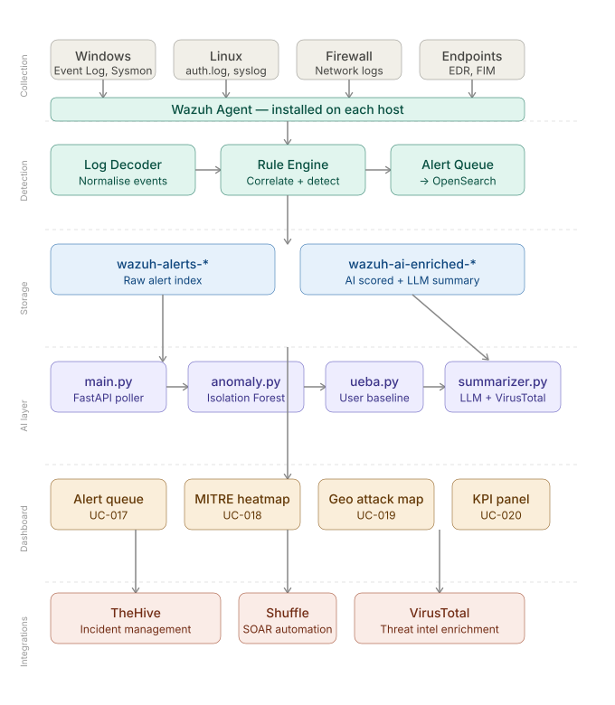

# 🛡️ siem-ai-dashboard

> An AI-powered, open-source SIEM dashboard for SOC teams —
> built on Wazuh, enriched with local ML anomaly detection and a
> self-hosted LLM explanation layer.


---

## 📌 Overview

**siem-ai-dashboard** is a proof-of-concept AI-enhanced Security Information and Event Management (SIEM) system built entirely on open-source tools. It extends Wazuh's native threat detection capabilities with a Python AI pipeline that scores alerts for anomalies, profiles user behaviour, sanitizes every alert before it reaches a language model, and generates plain-English explanations for SOC analysts — using a **self-hosted local model by default**, with a cloud provider available only as an explicit opt-in.

Unlike commercial SIEM solutions, this stack costs $0 in licensing and is fully customisable. It is designed for SOC teams, security engineers, and students who want a production-grade detection and response workflow without vendor lock-in — and without sending security telemetry to a third party by default.

---

## 🎯 Goals

1. ✅ Reduce alert fatigue for L1 analysts via an independent anomaly-score signal
2. ✅ Surface plain-English alert explanations using a local LLM — no data leaves the network by default
3. ✅ Detect common attack patterns mapped to MITRE ATT&CK framework
4. ✅ Automate tier-1 response actions via fixed policy rules — never decided by the AI itself
5. ✅ Enrich alerts automatically with threat intelligence (VirusTotal, GeoIP)
6. ✅ Provide a fully open-source, zero-cost alternative to commercial SIEMs

---

## 🏗️ Architecture



The system runs a staged AI pipeline — anomaly scoring, behavioural analysis, sanitization, then a local-by-default LLM explanation — kept strictly separate from the response layer. Automated actions (IP blocking, ticket creation) fire from fixed policy rules, never from the AI's own output. Full detail, including the design principles behind this separation, is in [`docs/02-architecture.md`](docs/02-architecture.md).

```
Log Sources → Wazuh Agent → Wazuh Manager → Wazuh Indexer
                                                  │
                              ┌───────────────────┴───────────────────┐
                              ▼                                       │
                    AI Pipeline (Python)                              │
                    Anomaly → UEBA → Sanitize → Local LLM (default)   │
                              │                                       │
                              └───────────────────┬───────────────────┘
                                                  ▼
                                    OpenSearch Dashboard
                                                  │
                              ┌───────────────────┴───────────────────┐
                              ▼                                       ▼
                    Policy-Driven Response                    Analyst Review
                    TheHive · Shuffle · Active Response
```

---

## 🛠️ Tech Stack

| Layer | Tools |
|---|---|
| **SIEM Core** | Wazuh, OpenSearch, OpenSearch Dashboards |
| **AI / ML** | Python 3.11, scikit-learn, FastAPI, Ollama (local, default) |
| **LLM (optional)** | Claude API / OpenAI API — opt-in upgrade path, off by default |
| **SOC Workflow** | TheHive, Shuffle SOAR, VirusTotal API |
| **Infra** | Docker Compose, Ubuntu 22.04 / WSL2 |
| **Testing** | Atomic Red Team, Caldera |
| **Docs** | Markdown, SVG diagrams |

---

## ✅ Use Cases (24 total)

| Category | Examples |
|---|---|
| 🔴 Threat detection | Brute force, lateral movement, privilege escalation, ransomware FIM, data exfil |
| 🟡 AI anomaly detection | Unusual login time, abnormal data volume, new device/IP per user |
| 🟢 SOC automation | Auto incident ticket, LLM alert explanation, auto IP block, hash lookup |
| 🔵 Dashboard visibility | Real-time alert queue, MITRE heatmap, geo attack map, analyst KPIs |

→ Full list in [`docs/03-use-cases.md`](docs/03-use-cases.md)

---

## ⚡ Quick Start

### Requirements

| Spec | Minimum (Core SIEM) | Recommended (Full stack incl. local LLM) |
|---|---|---|
| RAM | 8 GB | 16 GB+ |
| Disk | 60 GB free | 80 GB+ (add ~4–5 GB for a local model) |
| OS | Ubuntu 22.04 / WSL2 | Ubuntu 22.04 |
| Docker | 24.0+ | latest |

See [`docs/02-architecture.md`](docs/02-architecture.md#infrastructure-requirements) for the full RAM breakdown — running Core SIEM and the local LLM together on 16 GB is workable but tight.

### 1. Clone the repo

```bash
git clone https://github.com/berryliciousbunny/siem-ai-dashboard.git
cd siem-ai-dashboard
```

### 2. Set up environment variables

```bash
cp .env.example .env
```

Open `.env` and configure:

```env
# LLM provider — local by default, nothing leaves your network
LLM_PROVIDER=ollama
OLLAMA_MODEL=mistral
OLLAMA_URL=http://localhost:11434

# Optional: switch to a cloud provider instead (opt-in)
# LLM_PROVIDER=anthropic
# ANTHROPIC_API_KEY=your_key_here

VIRUSTOTAL_API_KEY=your_key_here        # optional, for hash/IP reputation
THEHIVE_URL=http://localhost:9000
THEHIVE_API_KEY=your_key_here
```

### 3. Start the full stack

```bash
docker compose up -d
```

This starts: Wazuh Manager, Wazuh Indexer, Wazuh Dashboard, TheHive, Shuffle, Ollama, and the Python AI microservice.

### 4. Access the dashboard

| Service | URL | Default credentials |
|---|---|---|
| Wazuh Dashboard | http://localhost:5601 | admin / SecretPassword |
| TheHive | http://localhost:9000 | admin@thehive.local / secret |
| Shuffle | http://localhost:3001 | set on first login |
| AI API (FastAPI) | http://localhost:8000/docs | — |

### 5. Install a Wazuh agent (on an endpoint to monitor)

```bash
# On the endpoint machine — replace WAZUH_MANAGER_IP with your server's IP
curl -so wazuh-agent.deb https://packages.wazuh.com/4.x/apt/pool/main/w/wazuh-agent/wazuh-agent_4.7.0-1_amd64.deb \
  && sudo WAZUH_MANAGER=WAZUH_MANAGER_IP dpkg -i ./wazuh-agent.deb
sudo systemctl start wazuh-agent
```

Once the agent is running, logs will start flowing into the dashboard within a few minutes.

---

## 📁 Project Structure

```
siem-ai-dashboard/
├── README.md
├── CONTRIBUTING.md
├── docker-compose.yml
├── .env.example
│
├── docs/
│   ├── 01-overview.md
│   ├── 02-architecture.md
│   ├── 03-use-cases.md
│   ├── 04-deployment.md
│   ├── 05-ai-layer.md
│   ├── 06-roadmap.md
│   └── 07-test-results.md
│
├── diagrams/
│   └── architecture.svg
│
├── rules/
│   ├── brute_force.xml
│   ├── off_hours_login.xml
│   ├── privilege_escalation.xml
│   ├── lateral_movement.xml
│   ├── ransomware_fim.xml
│   ├── data_exfil.xml
│   └── malicious_process.xml
│
├── dashboards/
│   ├── soc-analyst-view.json
│   └── ciso-summary-view.json
│
└── ai/
    ├── main.py
    ├── anomaly.py
    ├── ueba.py
    ├── sanitizer.py
    ├── summarizer.py
    ├── requirements.txt
    └── Dockerfile
```

---

## 🗺️ Roadmap

| Phase | Status |
|---|---|
| Phase 1 — Documentation & PoC planning | ✅ Complete |
| Phase 2 — Wazuh deployment | 🚧 In progress — stack deployed, Windows agent connected |
| Phase 3 — Custom detection rules | 🚧 In progress — several rules written, MITRE mapping + testing pending |
| Phase 4 — Custom OpenSearch dashboard | 🚧 In progress — real-time alert queue panel underway |
| Phase 5 — AI / ML layer | ⬜ Planned |
| Phase 6 — Integrations | ⬜ Planned |
| Phase 7 — Testing & red team simulation | ⬜ Planned |
| Phase 8 — Finalise & publish | ⬜ Planned |

→ Full details in [`docs/06-roadmap.md`](docs/06-roadmap.md)

---

## 🤝 Contributing

Contributions are welcome — new detection rules, dashboard panels, AI pipeline improvements, or documentation fixes.

→ See [`CONTRIBUTING.md`](CONTRIBUTING.md) for guidelines.

---

## 📄 License

MIT License — free to use, modify, and distribute.

---

> Built as a proof of concept for AI-enhanced SOC operations.
> Open-source stack, local-first AI — $0 licensing cost.